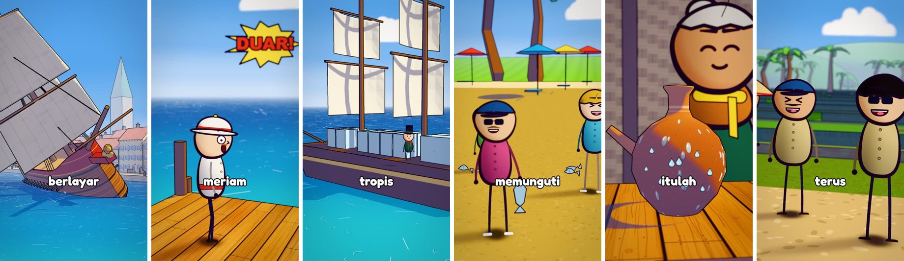
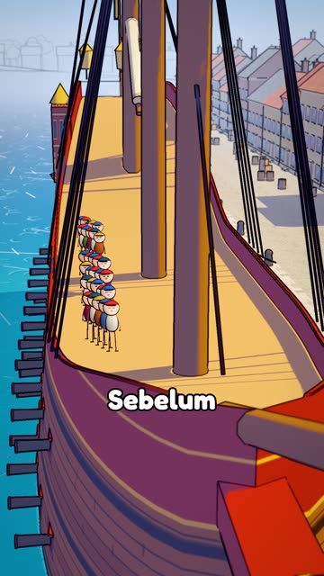
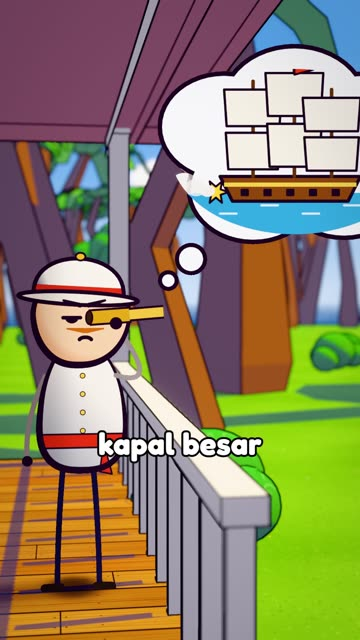
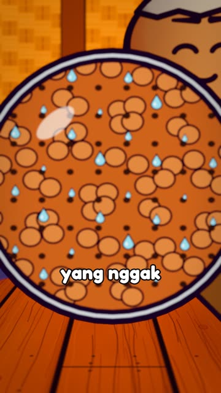
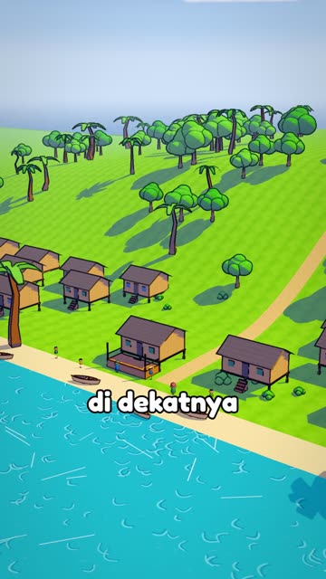
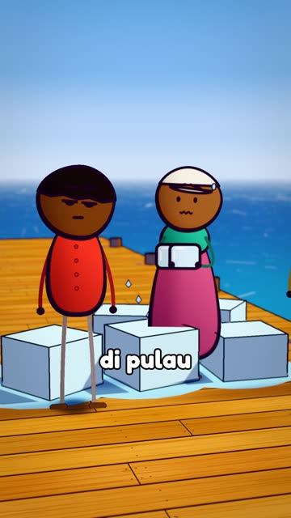
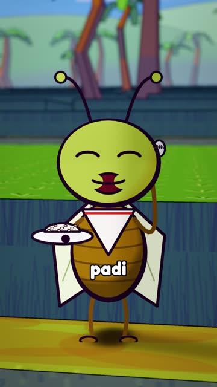

<p align="center">
  
</p>

<h1 align="center">Cartoon 3D Shorts</h1>

<p align="center">
  <b>Dua perintah, satu video Shorts animasi: dari ide cerita sampai MP4 siap upload.</b><br>
  Tokoh kartun 2D di dunia 3D, narator berbahasa Indonesia, caption per kata, musik dan efek suara.
</p>

<p align="center">
  <a href="#tampilan">Tampilan</a> ·
  <a href="#mulai-cepat">Mulai cepat</a> ·
  <a href="#membuat-video">Membuat video</a> ·
  <a href="#cara-kerja">Cara kerja</a> ·
  <a href="#konfigurasi">Konfigurasi</a> ·
  <a href="#faq">FAQ</a>
</p>

```text
/generate-naskah 5 sejarah Nusantara
/generate-vidio 2
```

Bukan generator video AI. Setiap frame dirender sendiri di PC kamu dengan three.js di dalam Remotion: dunia 3D bergaya lukisan dengan garis tinta, lensa dengan depth of field, kamera yang meluncur, dan tokoh kartun berkepala bulat. Claude Code yang menulis cerita, mengecek fakta, membangun adegan, memeriksa hasilnya, lalu merender.

Rumus ceritanya: **cerita dulu, sains belakangan.** Ada tokoh, ada situasi aneh, ada yang menertawakan, taruhannya naik, lalu di akhir terungkap mekanisme sains yang nyata sebagai twist.

---

## Tampilan

### Setiap kalimat digambar apa adanya

<table>
  <tr>
    <td align="center" width="33%"><br><sub><b>Kapal Perang yang Kalah oleh Angin</b><br>Dek kapal termegah Swedia, sebelum pelayaran pertamanya.</sub></td>
    <td align="center" width="33%"><br><sub><b>Suara Paling Keras dalam Sejarah Manusia</b><br>Gelembung pikiran 2D muncul tepat di kata kuncinya.</sub></td>
    <td align="center" width="33%"><br><sub><b>Kendi Bocor yang Bikin Air Tetap Sejuk</b><br>Sains mikroskopis dijelaskan lewat kaca pembesar, bukan diagram.</sub></td>
  </tr>
  <tr>
    <td align="center"><br><sub><b>Pulau yang Selamat Berkat Cerita Nenek</b><br>Cerita lokal Nusantara: tradisi <i>smong</i> di Simeulue.</sub></td>
    <td align="center"><br><sub><b>Orang yang Jualan Es ke Negeri Tropis</b><br>Tokoh utama punya warna dan aksesori khas di semua shot.</sub></td>
    <td align="center"><br><sub><b>Kenapa Petani Bali Menuruti Jadwal Pura</b><br>Dunia dibangun ulang untuk tiap cerita: sawah, pura, desa.</sub></td>
  </tr>
</table>

### Video yang sudah jadi

| Judul | Durasi | Slug |
|---|---|---|
| Kenapa Petani Bali Menuruti Jadwal Pura | 67 dtk | `subak_wereng` |
| Kaleng yang Lahir Tanpa Pembuka Kaleng | 67 dtk | `kaleng_pahat` |
| Kapal Perang yang Kalah oleh Angin | 65 dtk | `kapal_vasa` |
| Pulau yang Selamat Berkat Cerita Nenek | 64 dtk | `smong_simeulue` |
| Kendi Bocor yang Bikin Air Tetap Sejuk | 64 dtk | `kendi_keringat` |
| Dokter yang Menulari Anak dengan Penyakit Sapi | 64 dtk | `vaksin_sapi` |
| Orang yang Jualan Es ke Negeri Tropis | 63 dtk | `raja_es` |
| Pasir Hisap Nggak Bisa Menenggelamkanmu | 62 dtk | `pasir_hisap` |
| Seratus Rupiah yang Merebut Satu Pasar | 61 dtk | `harga_sembilan` |
| Suara Paling Keras dalam Sejarah Manusia | 61 dtk | `krakatau_suara` |
| Orang Indonesia yang Hidup di Dasar Laut | 61 dtk | `bajau_limpa` |

Kode tiap video ada di `src/videos/<slug>/`, naskah dan sumbernya di `projects/<slug>/`.

---

## Mulai cepat

### Prasyarat

- **Windows** (path alat di repo ini ditulis untuk Windows)
- **Node.js 24** atau lebih baru
- **Python 3.12**
- **Google Chrome** di `C:/Program Files/Google/Chrome/Application/chrome.exe` (dipakai Remotion dengan `--gl angle`)
- **ffmpeg/ffprobe** di `tools/ffmpeg/bin/`
- **Kunci API ElevenLabs** untuk narator, musik, dan efek suara
- **[Claude Code](https://claude.com/claude-code)** untuk menjalankan dua skill-nya
- Ruang disk kosong beberapa GB untuk bundle sementara Remotion dan hasil render

### 1. Clone dan pasang dependensi

```bash
git clone https://github.com/ryanmhildan/cartoon-3d-shorts.git
cd cartoon-3d-shorts
npm install
```

### 2. Siapkan Python

```bash
python -m venv .venv
.venv/Scripts/python.exe -m pip install numpy scipy pillow soundfile requests
```

### 3. Taruh ffmpeg

Unduh build ffmpeg untuk Windows, lalu salin `ffmpeg.exe` dan `ffprobe.exe` ke `tools/ffmpeg/bin/`.

### 4. Isi kunci suara

```bash
cp .env.example .env
```

Buka `.env`, isi `ELEVENLABS_API_KEY` dan `ELEVENLABS_VOICE_ID`. Untuk melihat Voice ID suara di akunmu:

```bash
.venv/Scripts/python.exe tools/voices_list.py
```

### 5. Buka studio

```bash
npm run studio
```

Remotion Studio terbuka di browser dan semua video di `src/Root.tsx` bisa diputar dan diperiksa per frame.

> [!NOTE]
> `voice.wav`, `mix.wav`, cache ElevenLabs, dan hasil render tidak ikut disimpan di repo. Membuat ulang suara dan musik memakai kredit ElevenLabs.

---

## Membuat video

### Langkah 1: Minta opsi naskah

Buka Claude Code di folder ini, lalu kirim:

```text
/generate-naskah 5 sejarah Nusantara
```

Angka = jumlah opsi (default 5, maksimal 8). Sisanya tema, boleh dikosongkan. Hasilnya masuk ke `topics/naskah_latest.md`: tiap opsi punya judul, hook, naskah lengkap 120–150 kata, skor "bisa digambar", dan minimal dua sumber. Topik di `topics/used.txt` otomatis dilewati.

### Langkah 2: Pilih satu dan jadikan video

```text
/generate-vidio 2
```

Boleh pakai nomor opsi atau judulnya. Claude lalu menjalankan seluruh alur: naskah final, suara, musik dan SFX, rencana shot, kode adegan, cek still, sampai render.

### Langkah 3: Terima hasilnya

| File | Isi |
|---|---|
| `out/<slug>/<slug>.mp4` | Video 1080x1920, 30 fps, 55–65 detik |
| `out/<slug>/upload.txt` | 3 ide judul, deskripsi tanpa spoiler, sumber, 5 hashtag |

Mau ada yang diubah? Bilang saja: *"tokoh utamanya pakai topi merah"*, *"musiknya lebih misterius"*, *"hook-nya diganti"*. Claude mengulang dari langkah yang terdampak saja.

---

## Cara kerja

```text
 /generate-naskah ─▶ riset ≥2 sumber ─▶ N opsi naskah ─▶ kamu memilih
                                                            │
 ┌──────────────────────────────────────────────────────────┘
 ▼
 /generate-vidio ─▶ script.txt + facts.md ─▶ suara ElevenLabs ─▶ musik + SFX + mix
                                                                     │
 ┌───────────────────────────────────────────────────────────────────┘
 ▼
 shots.md ─▶ kode adegan (three.js) ─▶ still per shot ─▶ render ─▶ MP4 + upload.txt
                     ▲                      │
                     └──── perbaiki ────────┘
```

1. **Naskah.** Rumusnya diukur dari 20 Shorts referensi: hook berupa paradoks di kalimat pertama, setting singkat, eskalasi 3–6 beat, satu beat misteri, kata pivot *"Ternyata,"*, lalu payoff ironis. Angka dan tahun ditulis dengan huruf supaya narator membacanya benar.
2. **Fakta.** Mekanisme sainsnya wajib nyata dan dicek dengan minimal dua sumber. Cerita boleh fiksi di sekitar mekanisme nyata, tapi tidak pernah mengarang kejadian, kutipan, atau koran lalu menyajikannya sebagai fakta.
3. **Suara.** `tools/voice.py` meminta narasi ke ElevenLabs dan menyimpan waktu tiap kata di `words.json`. Caption, potongan shot, dan efek suara semuanya mengikuti waktu ini.
4. **Musik dan SFX.** `tools/sound.py` membuat musik dan 8–15 efek suara tepat di kata kuncinya, lalu mencampurnya ke -14 LUFS dengan musik sekitar 10 dB di bawah suara. Hasil ElevenLabs di-cache, jadi menjalankan ulang tidak memakan kredit.
5. **Adegan.** Satu kalimat = satu shot. Video baru adalah salinan contoh `src/videos/bridge/`: nilai look (cahaya, tinta, lensa, grade) tetap sama, yang ditulis ulang hanya cerita, dunia, pemeran, dan kamera.
6. **Cek still.** `scripts/stills.mjs` merender satu frame per shot. Claude melihat setiap still: benda kunci terlihat, tokoh tidak terpotong, wajah tidak tertutup caption, tidak ada lubang atau benda melayang. Biasanya 3–5 putaran.
7. **Render.** `tools/finish.py` merender gambar dan menggabungkannya dengan `mix.wav`. Untuk render panjang, `tools/chunks.py` merender per 400 frame dengan browser baru tiap bagian.

### Struktur

```text
.claude/skills/
  generate-naskah/     skill pencari ide dan penulis naskah
  generate-vidio/      skill pembuat video (alur lengkap)
  cartoon-3d-short/    pipeline look 3D, nilai look final, STYLE_BIBLE, laporan terukur
src/
  Root.tsx             withCaptions() + satu <Composition> per video
  common/Captions.tsx  caption per kata (Fredoka Bold)
  videos/bridge/       contoh yang sudah terbukti, sumber semua kode look
  videos/<slug>/       satu folder per video
projects/<slug>/       script.txt, facts.md, shots.md, words.json, sound.json, length.json
tools/
  voice.py             ElevenLabs → voice.wav + words.json
  sound.py             musik + SFX + loudness → mix.wav
  finish.py            render + mux → MP4 final
  chunks.py            render per bagian untuk video panjang
  voices_list.py       daftar suara di akun ElevenLabs
  synth.py             musik dan SFX gratis tanpa internet
scripts/stills.mjs     still cepat untuk cek tampilan
public/bridge/kenney/  model 3D Kenney (CC0) yang dipakai
topics/                opsi naskah dan used.txt
```

---

## Konfigurasi

| Berkas | Isi |
|---|---|
| `.env` | Kunci, Voice ID, model, dan pengaturan suara ElevenLabs. Jangan pernah di-commit |
| `CLAUDE.md` | Aturan channel: bahasa, tempo suara, aturan fakta, setup |
| `projects/<slug>/sound.json` | Prompt musik dan daftar SFX per kata kunci |
| `topics/used.txt` | Topik yang sudah dibuat, dilewati oleh `/generate-naskah` |

| Variabel `.env` | Fungsi |
|---|---|
| `ELEVENLABS_API_KEY` | Kunci API ElevenLabs |
| `ELEVENLABS_VOICE_ID` | Suara narator (pastikan cocok untuk bahasa Indonesia) |
| `ELEVENLABS_SPEED` | Tempo bicara, 0.9–1.15. Dipakai kalau durasi meleset dari 55–65 detik |
| `ELEVENLABS_STABILITY`, `_SIMILARITY`, `_STYLE` | Opsional, default sudah cukup |

| Perintah | Fungsi |
|---|---|
| `tools/voice.py <script.txt> <dir>` | Buat narasi dan waktu per kata |
| `tools/sound.py projects/<slug>` | Buat musik, SFX, dan `mix.wav` |
| `node scripts/stills.mjs <CompId> <prefix> <frame,frame> 0.5` | Render still untuk dicek |
| `tools/finish.py <slug> <CompId>` | Render final. Tambah `--scale=1.3333` untuk 2K |

---

## Prinsip konten

- Sains selalu nyata, minimal dua sumber terpercaya, dan sumbernya ditulis di `facts.md` dan `upload.txt`.
- Cerita fiksi ditandai *"fiksi, sains nyata"*. Tidak ada tanggal, koran, atau kutipan tokoh nyata yang dikarang.
- Bahasa Indonesia lisan yang santai: "cuma", "nggak", "bayangin". Bukan bahasa buku pelajaran.
- Tokoh, warna, dan desain dibuat sendiri. Tidak meniru channel lain.
- Video berakhir di kata terakhir, tanpa "like dan subscribe".

---

## FAQ

**Render berhenti di tengah tanpa pesan error.** Biasanya GPU kehabisan memori. Pakai `tools/chunks.py <slug> <CompId> <total_frame>` untuk render per 400 frame; bagian yang sudah jadi tidak dirender ulang.

**Video final buram di beberapa shot, padahal still-nya tajam.** `cam.near` berubah antar shot. Biarkan nilainya tetap di semua shot.

**Kredit ElevenLabs habis.** Musik dan SFX bisa memakai synth bawaan yang gratis: `{"local": "playful"}` untuk musik, `{"local": "pop"}` untuk efek (`whoosh pop splash sting ding boing laugh ...`). Narasi bahasa Indonesia tetap butuh ElevenLabs.

**Disk penuh.** Hapus isi folder temp Remotion. Setiap bundle menyalin `public/` ke sana.

**Bisa untuk bahasa lain?** Bisa. Ganti suara di `.env`, lalu ubah aturan bahasa di `CLAUDE.md` dan kedua `SKILL.md`. Pipeline visualnya tidak bergantung pada bahasa.

**Butuh model 3D lain (kota modern, interior, kendaraan)?** Ambil kit dari [Kenney.nl](https://kenney.nl) (CC0), salin `.glb` yang dipakai ke `public/bridge/kenney/`.

---

## Kredit dan lisensi

- Pipeline look 3D di `.claude/skills/cartoon-3d-short/` dan contoh `src/videos/bridge/` berasal dari [mromidev/claude-animated-shorts](https://github.com/mromidev/claude-animated-shorts) (MIT). Frame dan contact sheet referensi dari repo itu **tidak** disertakan di sini.
- Model 3D dari [Kenney](https://kenney.nl) (CC0).
- Font [Fredoka](https://fonts.google.com/specimen/Fredoka) (SIL Open Font License).
- Skill bahasa Indonesia (`generate-naskah`, `generate-vidio`) dan video di tabel di atas: proyek pribadi. Silakan dipakai sebagai referensi dengan mencantumkan sumber.

<p align="center">
  <b>Cerita dulu, sains belakangan.</b><br>
  <sub>Dibuat dengan Claude Code, Remotion, dan three.js.</sub>
</p>
